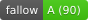
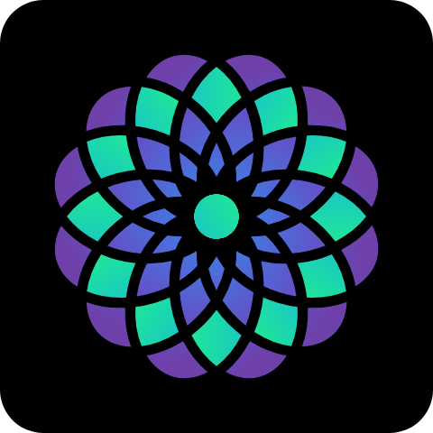
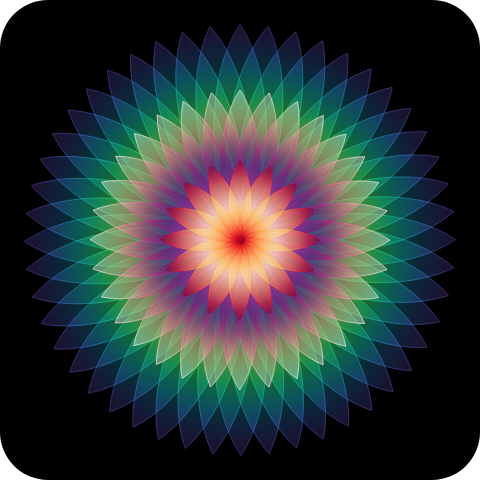
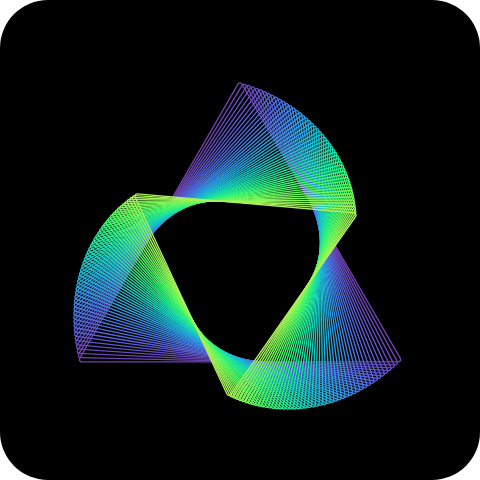
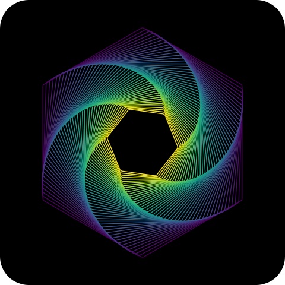
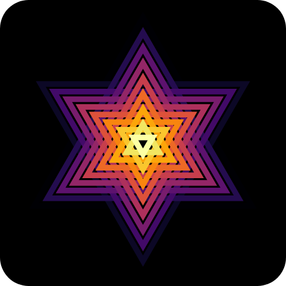
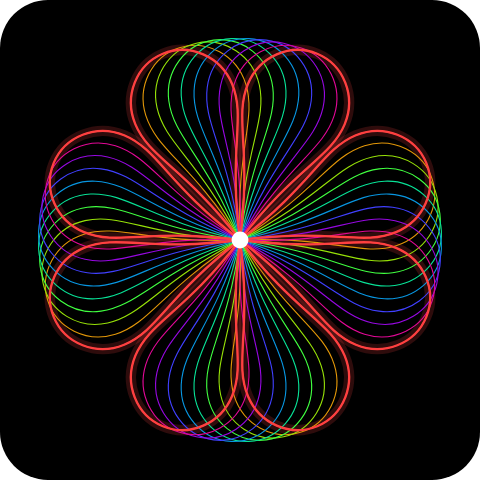

<p align="center">
  <a href="https://github.com/sponsors/niekes"></a>
</p>

<p align="center">
  <strong>An interactive line-art generator for the browser: geometric shapes, custom SVG paths, layers and gradients.</strong><br>
  Free and open source, kept alive by one maintainer and the people who sponsor the work.
</p>

<p align="center">
  <a href="https://github.com/Niekes/geometrica/actions/workflows/ci.yml"></a>
  <a href="https://github.com/Niekes/geometrica/actions/workflows/deploy.yml"></a>
  <a href="https://github.com/Niekes/geometrica/commits/master"></a>
  <a href="https://github.com/Niekes/geometrica/actions"></a>
  <a href="https://fallow.tools/docs/explanations/health/"></a>
  <a href="https://github.com/Niekes/geometrica/blob/master/LICENSE"></a>
  
  <a href="https://github.com/Niekes/geometrica"></a>
  <a href="https://github.com/sponsors/niekes"></a>
</p>

<p align="center">
  <a href="https://vuejs.org/"></a>
  <a href="https://vite.dev/"></a>
  <a href="https://vitest.dev/"></a>
  <a href="https://d3js.org/"></a>
  <a href="https://developer.mozilla.org/docs/Web/SVG"></a>
  <a href="https://webmachinelearning.github.io/webmcp/"></a>
  <a href="https://fallow.tools/"></a>
</p>

<p align="center">
  <a href="https://niekes.github.io/geometrica/">Live app</a> ·
  <a href="https://github.com/Niekes/geometrica/blob/master/CONTRIBUTING.md">Contributing</a> ·
  <a href="https://github.com/Niekes/geometrica/blob/master/AGENTS.md">Architecture &amp; quality gates</a>
</p>

---

<table>
    <tr style="background-color: #f6f8fa">
        <td><a target="_blank" href="https://niekes.github.io/geometrica/?c=G4XgTAZARg5gpAVgEIGMD2AbNAnRAREOMAZgAZyLp5k0AHAQxQEsAXAT3xAEYrEkocAEwCm2AEr1BTAK4BnTl1IQMfUvj4A7egFthnACrD6KsKRTCMGeafobBRUoLQtlq9cmBNZTKBj0ICFmxpYVdkNQC+OkZWDgDuMKQIvD5ZAAt6Wn8CFDkWNG1E5L4AMyZLAHkGZnYFIvckWSC0AGthKpja+KUVcIaYbEkmYQ0WfTYszgwmDSNsesjkAaGRlgBBDRg-Th63RaQGFjTOAFkAWgQADmIHM4A2O+ITgBZnrgdiO65zhABOW7Aly4ay4xAQDi4v3epi44NMahhDgRpDOYOeILBEKhH2ecPIEIcfwBQJBd2RYFhDlxSJp8IBFNJ5MppmIzPxdNMF3+nMBXAAXicEGAkfQhYThRzSND2TL+QsUsgdGhpKMFJBekkGlImrZzDt5XxsM56CwmGgNJxiGQDchZChjNkEhrisgUAAPThnADsPGdDRQcQIsN9ewVSCNLBNZo0AGEPfEfTbw8bTeaY4GQGdg0mmka2gB1JiCI4KZ455ptABSaBmnCNKsESfQWGwAElRqIAAqYE04TgzFiiWg9wcxtCYJOZWgYNhjlsAZRQaWEun0aAAoow0vOMpN4kEQkmStNaHOcO3B9hhxhe7h4iVjLJQn79gB3Isl+IILjq0N8ZdMDAaQsJw36-n0+wCNgIjiEMcj6L0BC7BBYZQTBEhSPBd5IUmaGiBhMiyEgiEgMhmqQUI+FwUR2GkUmgyYbIAAaoE-vR1EAJqseB5Fht4IjyF+uGUbBjH6i+fFMHyjqKGAZYSXwzbSNoGiCUG9FoK+alOn+rqYMpGgAOKZOJunJq+xm0KZKFRCUJRPiwYiadpD5WM+fDvPsWi6JwABy9DABwpjmJYsiJJ5YaeN4viOge7nIBFUTVLEdQaoltq7o6uRNAU4UNGUlTJV06lpQ0uatO0RUZmR6VIMsUirOMe4ENMsz0PMpX7PVwyjBsWyOmAdzyR5DSHMc8TnKYtzENcJyKKQzwOEN3wUtNdyXBieKQtKbLIjtdx4qiYC-IyDgUni1KSsiXrciix0IKdpjnTieLIkya2XAKXCLZykInaCW3YqYl2yktt1nGAVybVi0rECDe0OJcXq3FwN2PaQz2mF6r20qQxDg996JcGSZ1sqyOOSt9KO-L8ApZgTJDQzCQMLRTUq41m2NM1KLPk7jO0M8Q6OY6Q2O429ty-ETJNPWygJs8i9MoyQfJ5fsSoqiB8RsZ1YbapGGh6t0athhGUbmpa1q66k9rbNrJuKfGBDPL8PG1QGno-r8DvIGbqaxk7mYu27DR+9G6Zqt71u2hWwiFsW41BsNCVlbH1a1vE9Z2D7qCYOeHbYN2N75LRA5DiOwhjhO0dIFOM5ntgi7LquG5bjumSxcE8VILVx5MKeedtgX163pwcU5++CfcTnAFAVrBBgTneGiYRCHWT3DTLwRWHr7VW-UcRu+byJ280Uf+wMYRLFfjrI0X5x081-xwjaQgS8n9R5+SdJCgY8nG-7CUipbSIYU4X2cqlO+YYgFGRMsbGuRoLJwJwjXNAdkHJOS0pwVyT4gA"></a></td>
        <td><a target="_blank" href="https://niekes.github.io/geometrica/?c=G4XgTAZARg5gpAVgEIGMD2AbNAnRAREOMAZgAZzp5k0AHAQxQEsAXAT3xAEZLEkocAJgFNsAJToDGAVwDOHTqQgZepfLwB2dALZCOAYRxClKtcmCMZjKBl0ICzbFKPLkqu71oMW7O12OvTJBkACzoaWwIUWWY0LX8kNzxeADNGDAwAeXomNg5SADoEeMTeGQc0AGshLK9c3wKATmLAmGwJRiF1ZgAVVnCONsk6DGb3ZFb2zuYAQXUYGzzRpOR6ZmCOAFlVMFIFbdI9IlJiABYjhG3DndOjgFoLoivyO72jp9ubnfvLu8-SB7AT32rx2AC0lrxtGgpF15AA2CHISRlOjqFARECKFwJQLYNDMOjMRhodQcYjEAAciNQAA9FtiSsgUD4CBSsSYxkg8QSiSS9HT6tTuYTieo9CyQLc2dSyniqgB1RgCNbyQrU9BYbAASS6IgACphCTgOIxddgaIbmEIAJqZMQCalhGgYVgGTUAZRQwSEOm6aAAogxgu7Qv1fA4nNTkhhGDQ3TgdVbzZbjb5ksMZM4OcskAB3JUq3wITiQBmBb2MGDBZgcYul7O8fjYYRidqybouAjsgKcpst8SSdu4QVl3uCEQD6QyJCdzHUvsTtvT4ddoVLgAatZLa8HMmtW-rPZzlmEciL8-Hrd39IbyEsAC8MZxpdjOIFNDpNkqBAsdthTTA8Rvpy5iWNYGIRlmyDATmng5BK3CvoEIRhBiURlLEQGBKk6Q1PBeT5MQRRIZysqVNU2TeARTQkTmEySFMvRhgQgyMMMWGcvRHRdLM8wYt2SAwbwqzrL4WxHCCBxHH8AJPH83yPEc+y3JJ7zybJvxnDsGk7MCzxghxOZQjCNa+MQh6CYEyIEmi-GGbwwq8qSZknDRvBCUyAqrrRvDMvCAkeVy+IinyXlzj5yCOaK4ocCpcIBch5QKgWokEJwaoRagmAJmaBoYEaK4gKaSYWvlVqiAIepSPZyBOi68bYJ63q+gGQYhqhHCQTVSDRrGDWJiIpUFZ1jhQZZnL5sqqUgHW3UVlWpkELNmULleU4dje0GBKtk5Dpt405jtS4zvtgVHbuXKnbiG4Ht1rGyPuRbbplJ5CGeS3dedU5XaRjCPmSOzxGA77aBiGRSEmRz-nMQOBKBVgLOGo2w5ycFUb4iG8MDpGhmh0SYdi2M5jhmSUXUXb5GAxFY4lcoUbUEoFFShMtKxjF9BirHsSznFszxcyI95NOciJmx6fsclaf8PzXFLCmAkpLz6VJXzqTLpAfFLOnK5J4I80ZWjQrCvgnMzws5tZqLovtRMOcFTlkggFm255NuBH5vhgCcAku0FPLRWFPu4vb0USrcXtB6RSVCIqU2qs77vZdquUpoVxWDZaQgGJgKNGTQzquknTU+kIfqBl67XMSAXX6ykMZxknA3JmVqb2MjtfIJNhZLc95u8PN1a3R3fCXrtMgbSOffIF9e2T8gvsz9Os6R4do-HYVK8OTdT0J5y917kPU9BEqb21rnjZr9ec9IL7D4Yic3tAA"></a></td>
        <td><a target="_blank" href="https://niekes.github.io/geometrica/?c=G4XgTAZARg5gpAVgEIGMD2AbNAnRAREOMAZgAZzp5k0AHAQxQEsAXAT3xAEZLEkocAJgFNsAJToDGAVwDOHTqQgZepfLwB2dALZCOAGTqsRRUt2XJVCPL2CMZjKBl1WQzbFKFKVa6vSZt5LwsfJBkACzoaZwIaTFYYNHUgpEtrZAAzRgwMAHk-FnYXRXMUkJk3NABrITyGAsCS1N4YbAlGIXVmABVWKI4MRnUhOmxkpuQWto7mAEF1GCcOYu8rXnpmMI4xkO00KU6OBGXg1eRJcrp1FGiQBG3TpGw0ZjpmRkSOADY7xpCUAA8lvc0qhCgQALSfY6lB5PF5vRIAYUBRWBvDhr3e6kRYJA0PGoQq1QA6owBBsOMQ0ch0FhsABJToiAAKmFeOA4g2YIliGFeQkRaEw1KQkRoGFYgrpAGUUGEhDoumgAKIMMLSiJ9FzpOgYGSeX4PdIDGhSnCM7nYXns3Da3X6kUAdzJFJcCE4kENIPljBgYWYhw9Iv42GEYjasi65gI+JCIbD4kkkdtMeDghEiekMiQ0bxadDGYj2ZTea96KLAA1A56ViDWkmZABNasi+zCOQuKll5DxwsNpYAOlIP1rvHsAC8bgAOCjdvgwJDp8P9lwKYMwM0lohkchAA"></a></td>
    </tr>
    <tr style="background-color: #f6f8fa">
        <td><a target="_blank" href="https://niekes.github.io/geometrica/?c=G4XgTAZARg5gpAVgEIGMD2AbNAnRAREOMAZgAZzp5k0AHAQxQEsAXAT3xAEZLEkocAJgFNsAJToDGAVwDOHTqQgZepfLwB2dALZCOAGTqsRRUt2XJVCPL2CMZjKBl1WQzbFKFKVa6vSZt5LwsfJBkACzoaZwIaTFYYNHUgpEtrZAAzRgwMAHk-FnYXRXMUkJk3NABrITyGAsCS1N4YbAlGIXVmABVWKI4MRnUhOmxkpuQWto7mAEF1GCcOYu8rXnpmMI4xkO00KU6OBGXg1eRJcrp1FGiuTgA6ADZt06RsNGY6ZkZEjgBOAA5nmlUAAPJZA3goQoEY6lF5vD5fRIAYTBRQhyARn2+6mR0JAsPGoQq1QA6owBBsOMQMahMDgAJKdEQABUwnxwHEGzBEsQwnyEADVGNgKXZaZEaBhWMj6dgAMooMJCHRdNAAUQYYXlET6LnSdAwMk8jRC6QGNFlWGwTJ52D5HNw+sNxtpAHcKVSXAhOJBTS9lYwYGFmIdfbT+NhhGI2rIuuYYRHBCJxJI407E-7gZHo6npDIkAmCUmoynYwWM8Ws7xWmmZAANMN+lbA2v5gCaTdp9mEchcT2ryBzZbrSzuZhbvHsAC8bv8wAB2CMwJDJmOjlwKZdWzkuIhkchAA"></a></td>
        <td><a target="_blank" href="https://niekes.github.io/geometrica/?c=G4XgTAZARg5gpAVgEIGMD2AbNAnRAREOMAZgAZzp5k0AHAQxQEsAXAT3xAEZLEkocAJgFNsAJToDGAVwDOHTqQgZepfLwB2dALZCOAGTqsRRUt2XJVCPL2CMZjKBl1WQzbFKFKVa6vSZt5LwsfJBkACzoaZwIaTFYYNHUgpEtrZAAzRgwMAHk-FnYXRXMUkJk3NABrITyGAsCS1N4YbAlGIXVmABVWKI4MRnUhOmxkpuQWto7mAEF1GCcOYu8rXnpmMI4xkO00KU75ADZt1eRJcrp1FGiQBAAWADoAdhO0pGw0ZjpmRkSOAE4KI0QigAB5LV68FCFAjLYKnd6fb6-dQAYXBRUhyA+Xx+iVRMJAcNKCPKH2qAHVGAINhwwKQHsQsahMDgAJKdEQABUw3xwHEGzBEsQw3yEHPSInUaGZkRoGFYqNZ2AAyigwkIdF00ABRBhhFURPoudJ0DAyTzAhHpAY0JVYbAcoXYEV83Ams0W5kAd2ptJcCE4kCtbw1jBgYWYHEDwZWb342GEYjasi65lhzITSfEklT7ozId4WZEOekMiQ6aJmcEJZT5fzVcL2LrAA1o0Hma1czIAJrt2Pwt72YRyFxMpt8GvJ7sQif2ABeN0BxPGfBgSCnpdk8hXIVg9v5LiIZHIQA"></a></td>
        <td><a target="_blank" href="https://niekes.github.io/geometrica/?c=G4XgTAZARg5gpAVgEIGMD2AbNAnRAREOMAZgAZyLp5k0AHAQxQEsAXAT3xAEYrEkocAEwCm2AEr1BTAK4BnTl1IQMfUvj4A7egFthnAMI5hy1euTAmsplAx6EBFtmnGVyNfb51GrDve4m3MyRZAAt6WjsCZmwUWwCkdzw+ADMmDAwAeQZmdgV4xL5ZRzQAa2Es71y-JVcEoJhsSSZhDRYAFTYIzgwmDWF6bHz6xqkWlgBBDRhbThrTD2QGFhDOIYWkHTRpVrzaguQpIvoNFEiQYkg9oOw0FnoWJjQNWbWk5BQADxer9ZRfAjmgXWNzuDye+i+1VefBB90eGn0-xAgLq6yKNzKAHUmIJlpxiNDkOjSsIAFJoXqcbSsUSE1CYHAASVaogACph7jhOL0WKJaBzeQBxbDCNiyOnhWgYNiGLDYADKKBCwl0bTQAFFGCF5WEun5kvQMLIXPM3khkj1aLKmSzsPyMJzcPrDca6QB3HF4vwILiXU18ZVMGAhFicH1+oFmgTYETiJpyNquAF06OxiRSBNO5M-KNCUTpmSyJBJ5EpvNxjNFrOlnMw+OyAAa+IAbHSRoWAJotulWETyb1lmP5+vff1EpgALzO4fiXCCWl0nAy0hYPT6s6CFisNjOjmcG-WXhySJ4tTnaN1ZxQchYaG0B7NqXSFWPo+Q57NxLKL58uz4H74BomjGDo9QINd+kGM9hmA1pJmmM4UQAxZ7hWPwAFkAFpwyIUhsN9dCcLAUhw3QtRiNIfRMLABAADoEFwzCuAATmIWjiFwrg2LARiwGbUh2MYrhm1ogAORjiAuMSqIAFi4WiZIk5ieOIpjSAAdnoxiZOI2jmKE5sZNo5slM04gqLAMB5JM1TiHUtibLwsAZPE2zSBEhjVMstjFK8mTNLAKiWJ8oT1KM9ShK4UTaIi1SuAQcLcPI8gAC0yKS-RgsEry6M80g+IEjjiK42iVNISSwDEgzpOIZTtPk3zSB0gT9LijStOI2qzIMozm30OyHN4qzjNwsgPN4lzcOcgKhp8zKwpioTWIUziEsWuKovW8gkrS5LKJojrSCyoq8JKsqCuyo6RNc8qpNE-Q5JWzq6uK9q8uavTOMMkbnrM-RLOs0b7J+-LJs69zDu8p7QYCzLlsargFtio7NuR+LEoonb0oooLlpOg68uo-jLqY7iJLur7pMw2qysexrMI+1qjre0zLuE3qqIGkGAZB6mIby5ybuo-zSqmkgFKCpHOPhoS1rR1Gkp2h8+E2bZQz8CMkGQpBDjuE5EOV5BYTBZ4-BkhBDdQSFs3-II-jfLXrluOFwWtmtbeBZ2TcRB3ta-YRsVxNCCAt6C0WKMpyUpPwbm2QRLfQOVmV5bB2QdW9qx5PkBWEeVemEAQ3UtyVpWtBUlRVYQ1U1JUdXCM4DSNE13yCC0mCtBlsGT7P065Z0m8tj0g7DX1LcDYN1ZD0ew9zIcK0LRNfaCVNh0rNpqyQ5fywLORiyX9YV-n3eN8t9s5Cbb1p49s0z9kLtL81v2cWEfsQ8tw+d9f92W7RSczkUZy8QeLrAXGcVkwg7hGiAZuSw1gZh+D3M3JAwCzRHl-H4U8fAUGFEvJwa8RQ7zQPWE+TI2R0E22QNgokEdyhkKqAQTBlCYKjFaKBM4EEBhELNEBFhEwpjwIocgoISxg4gCwkRPCpEJGkT2hZXKS02InTOrxYmJ0mLXXJpVe6DMGpKTKmpTShNGY9V5l1diFlhqOWpsDKxgsJL81mtDYWsMmIyzilLDa0VkZMTlorCiu0MrHV4vI4iF0lFk06hTOK11+ovTwnTXCxi2qGNGsxbq0SOZc1sZY0aDi-I3WmqLLy4sZLzQxqdNxR1fGeK2ntAJOMCbS0UUJCJ+VVGUxuhVaSCTnplUUCk4iSSrq9VSX9HmjkslTTBuVPJ+USlTNhllBGHiUZeNWuUup2NyC42aaEkJTl2lxVadTKJV0qY00Sbo1SQz+mHWpmktm30+rWMGqEnJblxqhOmc4opcy5pMRWUs2W5SuAK0xv4rhKttBbB2BglEVCdaWD1qcB2CLjbwk4ObSF7w3bwrtkiPFntQTwghKip2xLwQEuxcEGhgcvQEEqjJal-so6mwILHDQ8dagIsTjaFOadHTcltPae4ud86F2pSXGUndFTKlVBqLUdcwIgEbq6blrdLRl27naAUfcCCqqQQioe9KQAznVesceIYR6awRR-esi8oTmtnmme1J8nV8DtZWPejqsFbznp-JAbrfXAnrBfKeNrrj1nvuG5lz8v6h2Dc61ehYyW-ynAoUG8QOIgJ0GcQUWAi61GzWaLccDdxOCQcWzwdCCW0SilmoIoR654JvIQotrc0ikMqFS9t4cMS0O7X+ZAVbkA8OaKwzo7D86cN7dw9sYx4ICO-kgEdSARGcHEb6RiUit3ERkRlai+zXG7KOscsJ1UhZdO0T0vCFzkl3KGeokZtkHnmWou829NiJqXtme+kKfkXFAvceUpiYLTrVO2v4rZlEgk5Uhoc09vyr0Xtifom9j7bl5TMWo9mxl+pfuKYDcGnynLTMKfoqGpTEYgaA1UmjYHNmyMacVPGLTfnnuKhoyJWiHpXPKnEzDiTdJM1wxM19-0P2TK+Z02ZlGFmlThv+o6gKwPo1qVjWRx7LrMYOYVNj+jkOcfOXEm9DNhOcRZi+9Jwy8MvO5h+vmJG7EAfYyUyWILKk+JBQxpWs6oUwsnuABt6xdbHBRT64d5KXZspAFivzOKHarvthFldUXva4uCzfL2JKe18FXf7OlojLKZcKDQ1lnAOVcry3bTu2qBUZyFSnEVvI859AlfFjYtApTSrlLKyu1dFW4P7mq6rxDNW1eFbq6sBqSvIGNaIs1o2zSWsC4tyLB9t72pLCiVdnqF5BvW0mo+RZtuzf4Jtr1B3UshsrGG01V9Dt1krNG+7mt8txrDGdvbchEuNr-hm5yQA"></a></td>
    </tr>
</table>

More artwork in the in-app [gallery](https://niekes.github.io/geometrica/).

## Sponsor Geometrica

**Geometrica** is free, and it always will be. There is no company behind it — just one maintainer working in spare time — so the cost of keeping it alive is paid for by the people who depend on it.

If Geometrica saves you time, [become a sponsor](https://github.com/sponsors/niekes).

| Tier        | What you get                                                                                |
| ----------- | ------------------------------------------------------------------------------------------- |
| **$5/mo**   | Your name in the [sponsors list](#sponsors) and my sincere thanks                           |
| **$25/mo**  | The above, plus your logo in this README and priority issue triage                          |
| **$100/mo** | The above, plus direct email access for feature requests and a mention in the release notes |

Where the money goes:

- **Issue triage and bug fixes.** Sponsorship buys a reply within a couple of days instead of whenever I get to it.
- **An engine that stays correct.** Keeping the renderer, the SVG path parser and the URL state in shape as Vue and the SVG spec move on.
- **The artwork pipeline.** Gallery pieces, examples and the shareable-link format.
- **Time for new work.** More shape presets, better gradient controls, and whatever the community dreams up.

Prefer a one-off? The [sponsor page](https://github.com/sponsors/niekes) also takes one-time contributions.

**Need a company sponsorship or an invoice?** [Get in touch](mailto:s@niekes.com).

## Sponsors

Thank you to the people who make this possible. Sponsors at $25/mo and above get their logo in this README; everyone gets their name below.

<!-- New sponsors go below this line, one per line. -->

## Using Geometrica

No install — it runs in the browser at [niekes.github.io/geometrica](https://niekes.github.io/geometrica/).

### With an AI agent

Describe the effect you want and let an AI agent compose the layers: **Use with AI** in the [app](https://niekes.github.io/geometrica/) connects Claude Code through [WebMCP](https://webmachinelearning.github.io/webmcp/) in two steps.

To work on it locally:

```bash
npm install
npm run dev
```

Everything about the codebase, the architecture zones and the quality gates lives in [AGENTS.md](AGENTS.md) and [CONTRIBUTING.md](CONTRIBUTING.md).

## Star History

[](https://www.star-history.com/#niekes/geometrica&type=date&legend=bottom-right)
