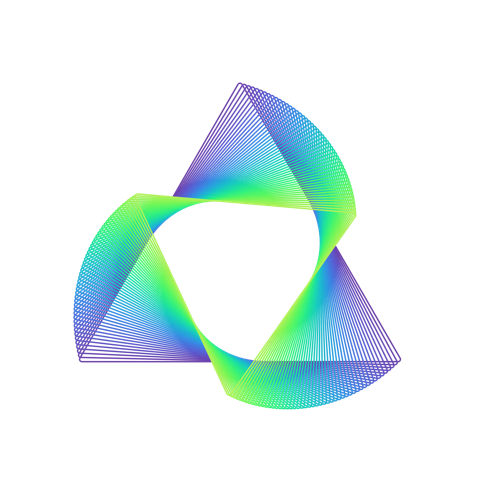
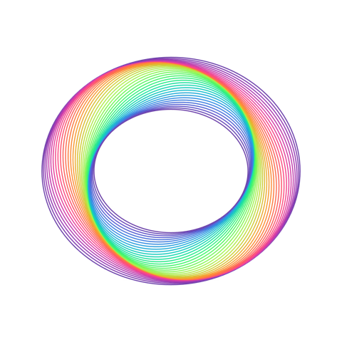
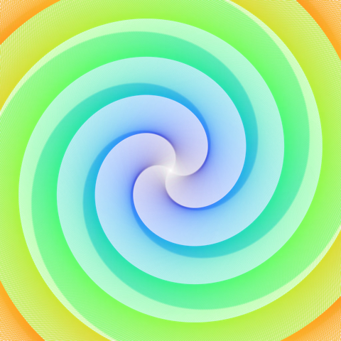
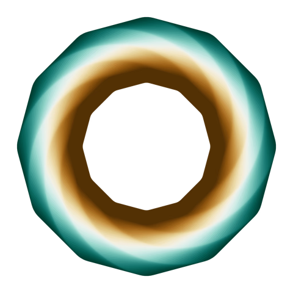
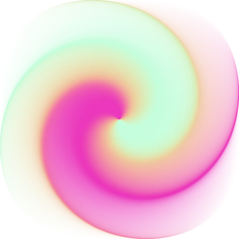
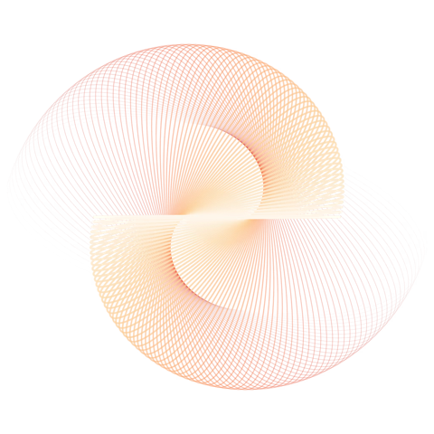

<p align="center">
  <a href="https://github.com/sponsors/niekes"></a>
</p>

<p align="center">
  <strong>An interactive line-art generator for the browser: geometric shapes, custom SVG paths, layers and gradients.</strong><br>
  Free and open source, kept alive by one maintainer and the people who sponsor the work.
</p>

<p align="center">
  <a href="https://github.com/Niekes/geometrica/actions/workflows/ci.yml"></a>
  <a href="https://github.com/Niekes/geometrica/actions/workflows/deploy.yml"></a>
  <a href="https://github.com/Niekes/geometrica/commits/master"></a>
  <a href="https://github.com/Niekes/geometrica/actions"></a>
  <a href="https://fallow.tools/docs/explanations/health/"></a>
  <a href="https://github.com/Niekes/geometrica/blob/master/LICENSE"></a>
  
  <a href="https://github.com/Niekes/geometrica"></a>
  <a href="https://github.com/sponsors/niekes"></a>
</p>

<p align="center">
  <a href="https://vuejs.org/"></a>
  <a href="https://vite.dev/"></a>
  <a href="https://vitest.dev/"></a>
  <a href="https://d3js.org/"></a>
  <a href="https://developer.mozilla.org/docs/Web/SVG"></a>
  <a href="https://webmachinelearning.github.io/webmcp/"></a>
  <a href="https://fallow.tools/"></a>
</p>

<p align="center">
  <a href="https://niekes.github.io/geometrica/">Live app</a> ·
  <a href="https://github.com/Niekes/geometrica/blob/master/CONTRIBUTING.md">Contributing</a> ·
  <a href="https://github.com/Niekes/geometrica/blob/master/AGENTS.md">Architecture &amp; quality gates</a>
</p>

---

<table>
    <tr style="background-color: #f6f8fa">
        <td><a target="_blank" href="https://niekes.github.io/geometrica/?shape=polygon&rect%5Bamount%5D=16&rect%5BapplyColorSchemeToEachShape%5D=false&rect%5BbgBorderRadius%5D=10&rect%5BbgColor%5D=%23000&rect%5BborderRadiusBl%5D=0&rect%5BborderRadiusBr%5D=0&rect%5BborderRadiusTl%5D=0&rect%5BborderRadiusTr%5D=0&rect%5BcalcOpacity%5D=&rect%5BcalcStrokeWidth%5D=&rect%5BcolorInterPolator%5D=interpolateMagma&rect%5Bcx%5D=0&rect%5Bcy%5D=0&rect%5Bdistance%5D=32&rect%5BflipColorInterpolator%5D=false&rect%5Bheight%5D=512&rect%5Brotation%5D=0&rect%5BstrokeWidth%5D=3&rect%5Bwidth%5D=512&circle%5Bamount%5D=16&circle%5BapplyColorSchemeToEachShape%5D=false&circle%5BbgBorderRadius%5D=10&circle%5BbgColor%5D=%23000&circle%5BcalcOpacity%5D=&circle%5BcalcStrokeWidth%5D=&circle%5BcolorInterPolator%5D=interpolateMagma&circle%5Bcx%5D=0&circle%5Bcy%5D=0&circle%5Bdistance%5D=32&circle%5BflipColorInterpolator%5D=false&circle%5BradiusX%5D=512&circle%5BradiusY%5D=512&circle%5Brotation%5D=0&circle%5BstrokeWidth%5D=3&polygon%5Bamount%5D=50&polygon%5BapplyColorSchemeToEachShape%5D=false&polygon%5BbgBorderRadius%5D=10&polygon%5BbgColor%5D=%23000&polygon%5BborderRadius%5D=0.05&polygon%5BcalcOpacity%5D=&polygon%5BcalcStrokeWidth%5D=&polygon%5BcolorInterPolator%5D=interpolateCool&polygon%5Bcx%5D=0&polygon%5Bcy%5D=-60&polygon%5Bdistance%5D=5&polygon%5BflipColorInterpolator%5D=false&polygon%5Brotation%5D=65&polygon%5Bsides%5D=3&polygon%5Bsize%5D=800&polygon%5BstrokeWidth%5D=3"></a></td>
        <td><a target="_blank" href="https://niekes.github.io/geometrica/?shape=circle&rect%5Bamount%5D=16&rect%5BapplyColorSchemeToEachShape%5D=false&rect%5BbgBorderRadius%5D=10&rect%5BbgColor%5D=%23000&rect%5BborderRadiusBl%5D=0&rect%5BborderRadiusBr%5D=0&rect%5BborderRadiusTl%5D=0&rect%5BborderRadiusTr%5D=0&rect%5BcalcOpacity%5D=&rect%5BcalcStrokeWidth%5D=&rect%5BcolorInterPolator%5D=interpolateMagma&rect%5Bcx%5D=0&rect%5Bcy%5D=0&rect%5Bdistance%5D=32&rect%5BflipColorInterpolator%5D=false&rect%5Bheight%5D=512&rect%5Brotation%5D=0&rect%5BstrokeWidth%5D=3&rect%5Bwidth%5D=512&circle%5Bamount%5D=40&circle%5BapplyColorSchemeToEachShape%5D=false&circle%5BbgBorderRadius%5D=10&circle%5BbgColor%5D=%23000&circle%5BcalcOpacity%5D=&circle%5BcalcStrokeWidth%5D=&circle%5BcolorInterPolator%5D=interpolateRainbow&circle%5Bcx%5D=0&circle%5Bcy%5D=0&circle%5Bdistance%5D=8&circle%5BflipColorInterpolator%5D=false&circle%5BradiusX%5D=774&circle%5BradiusY%5D=682&circle%5Brotation%5D=90&circle%5BstrokeWidth%5D=3&polygon%5Bamount%5D=16&polygon%5BapplyColorSchemeToEachShape%5D=false&polygon%5BbgBorderRadius%5D=10&polygon%5BbgColor%5D=%23000&polygon%5BborderRadius%5D=0&polygon%5BcalcOpacity%5D=&polygon%5BcalcStrokeWidth%5D=&polygon%5BcolorInterPolator%5D=interpolateMagma&polygon%5Bcx%5D=0&polygon%5Bcy%5D=0&polygon%5Bdistance%5D=32&polygon%5BflipColorInterpolator%5D=false&polygon%5Brotation%5D=0&polygon%5Bsides%5D=5&polygon%5Bsize%5D=512&polygon%5BstrokeWidth%5D=3"></a></td>
        <td><a target="_blank" href="https://niekes.github.io/geometrica/?shape=rect&rect%5Bamount%5D=1000&rect%5BapplyColorSchemeToEachShape%5D=false&rect%5BbgBorderRadius%5D=10&rect%5BbgColor%5D=%23000&rect%5BborderRadiusBl%5D=0&rect%5BborderRadiusBr%5D=0&rect%5BborderRadiusTl%5D=0&rect%5BborderRadiusTr%5D=0&rect%5BcalcOpacity%5D=interpolate&rect%5BcalcStrokeWidth%5D=flip&rect%5BcolorInterPolator%5D=interpolateTurbo&rect%5Bcx%5D=0&rect%5Bcy%5D=0&rect%5Bdistance%5D=-1.8&rect%5BflipColorInterpolator%5D=false&rect%5Bheight%5D=1&rect%5Brotation%5D=-707&rect%5BstrokeWidth%5D=5.8&rect%5Bwidth%5D=1&circle%5Bamount%5D=16&circle%5BapplyColorSchemeToEachShape%5D=false&circle%5BbgBorderRadius%5D=10&circle%5BbgColor%5D=%23000&circle%5BcalcOpacity%5D=&circle%5BcalcStrokeWidth%5D=flip&circle%5BcolorInterPolator%5D=interpolateMagma&circle%5Bcx%5D=0&circle%5Bcy%5D=0&circle%5Bdistance%5D=32&circle%5BflipColorInterpolator%5D=false&circle%5BradiusX%5D=512&circle%5BradiusY%5D=512&circle%5Brotation%5D=0&circle%5BstrokeWidth%5D=3&polygon%5Bamount%5D=16&polygon%5BapplyColorSchemeToEachShape%5D=false&polygon%5BbgBorderRadius%5D=10&polygon%5BbgColor%5D=%23000&polygon%5BborderRadius%5D=0&polygon%5BcalcOpacity%5D=&polygon%5BcalcStrokeWidth%5D=&polygon%5BcolorInterPolator%5D=interpolateInferno&polygon%5Bcx%5D=0&polygon%5Bcy%5D=0&polygon%5Bdistance%5D=54.7&polygon%5BflipColorInterpolator%5D=false&polygon%5Brotation%5D=900&polygon%5Bsides%5D=3&polygon%5Bsize%5D=900&polygon%5BstrokeWidth%5D=20.3"></a></td>
    </tr>
    <tr style="background-color: #f6f8fa">
        <td><a target="_blank" href="https://niekes.github.io/geometrica/?shape=polygon&rect%5Bamount%5D=16&rect%5BapplyColorSchemeToEachShape%5D=false&rect%5BbgBorderRadius%5D=10&rect%5BbgColor%5D=%23000&rect%5BborderRadiusBl%5D=0&rect%5BborderRadiusBr%5D=0&rect%5BborderRadiusTl%5D=0&rect%5BborderRadiusTr%5D=0&rect%5BcalcOpacity%5D=&rect%5BcalcStrokeWidth%5D=&rect%5BcolorInterPolator%5D=interpolateMagma&rect%5Bcx%5D=0&rect%5Bcy%5D=0&rect%5Bdistance%5D=32&rect%5BflipColorInterpolator%5D=false&rect%5Bheight%5D=512&rect%5Brotation%5D=0&rect%5BstrokeWidth%5D=3&rect%5Bwidth%5D=512&circle%5Bamount%5D=16&circle%5BapplyColorSchemeToEachShape%5D=false&circle%5BbgBorderRadius%5D=10&circle%5BbgColor%5D=%23000&circle%5BcalcOpacity%5D=&circle%5BcalcStrokeWidth%5D=&circle%5BcolorInterPolator%5D=interpolateMagma&circle%5Bcx%5D=0&circle%5Bcy%5D=0&circle%5Bdistance%5D=32&circle%5BflipColorInterpolator%5D=false&circle%5BradiusX%5D=512&circle%5BradiusY%5D=512&circle%5Brotation%5D=0&circle%5BstrokeWidth%5D=3&polygon%5Bamount%5D=50&polygon%5BapplyColorSchemeToEachShape%5D=false&polygon%5BbgBorderRadius%5D=10&polygon%5BbgColor%5D=%23000&polygon%5BborderRadius%5D=0.67&polygon%5BcalcOpacity%5D=flip&polygon%5BcalcStrokeWidth%5D=&polygon%5BcolorInterPolator%5D=interpolateBrBG&polygon%5Bcx%5D=0&polygon%5Bcy%5D=0&polygon%5Bdistance%5D=7.3&polygon%5BflipColorInterpolator%5D=true&polygon%5Brotation%5D=90&polygon%5Bsides%5D=12&polygon%5Bsize%5D=860&polygon%5BstrokeWidth%5D=51.3"></a></td>
        <td><a target="_blank" href="https://niekes.github.io/geometrica/?shape=rect&rect%5Bamount%5D=1000&rect%5BapplyColorSchemeToEachShape%5D=true&rect%5BbgBorderRadius%5D=10&rect%5BbgColor%5D=%23000&rect%5BborderRadiusBl%5D=0.81&rect%5BborderRadiusBr%5D=0.81&rect%5BborderRadiusTl%5D=0.81&rect%5BborderRadiusTr%5D=0.81&rect%5BcalcOpacity%5D=interpolate&rect%5BcalcStrokeWidth%5D=&rect%5BcolorInterPolator%5D=interpolateMegatron&rect%5Bcx%5D=0&rect%5Bcy%5D=0&rect%5Bdistance%5D=1.0999999999999999&rect%5BflipColorInterpolator%5D=false&rect%5Bheight%5D=1024&rect%5Brotation%5D=284&rect%5BstrokeWidth%5D=2.6&rect%5Bwidth%5D=1024&circle%5Bamount%5D=16&circle%5BapplyColorSchemeToEachShape%5D=false&circle%5BbgBorderRadius%5D=10&circle%5BbgColor%5D=%23000&circle%5BcalcOpacity%5D=&circle%5BcalcStrokeWidth%5D=&circle%5BcolorInterPolator%5D=interpolateMagma&circle%5Bcx%5D=0&circle%5Bcy%5D=0&circle%5Bdistance%5D=32&circle%5BflipColorInterpolator%5D=false&circle%5BradiusX%5D=512&circle%5BradiusY%5D=512&circle%5Brotation%5D=0&circle%5BstrokeWidth%5D=3&polygon%5Bamount%5D=16&polygon%5BapplyColorSchemeToEachShape%5D=false&polygon%5BbgBorderRadius%5D=10&polygon%5BbgColor%5D=%23000&polygon%5BborderRadius%5D=0&polygon%5BcalcOpacity%5D=&polygon%5BcalcStrokeWidth%5D=&polygon%5BcolorInterPolator%5D=interpolateMagma&polygon%5Bcx%5D=0&polygon%5Bcy%5D=0&polygon%5Bdistance%5D=32&polygon%5BflipColorInterpolator%5D=false&polygon%5Brotation%5D=0&polygon%5Bsides%5D=5&polygon%5Bsize%5D=512&polygon%5BstrokeWidth%5D=3"></a></td>
        <td><a target="_blank" href="https://niekes.github.io/geometrica/?shape=circle&rect%5Bamount%5D=16&rect%5BapplyColorSchemeToEachShape%5D=false&rect%5BbgBorderRadius%5D=10&rect%5BbgColor%5D=%23000&rect%5BborderRadiusBl%5D=0&rect%5BborderRadiusBr%5D=0&rect%5BborderRadiusTl%5D=0&rect%5BborderRadiusTr%5D=0&rect%5BcalcOpacity%5D=&rect%5BcalcStrokeWidth%5D=&rect%5BcolorInterPolator%5D=interpolateMagma&rect%5Bcx%5D=0&rect%5Bcy%5D=0&rect%5Bdistance%5D=32&rect%5BflipColorInterpolator%5D=false&rect%5Bheight%5D=512&rect%5Brotation%5D=0&rect%5BstrokeWidth%5D=3&rect%5Bwidth%5D=512&circle%5Bamount%5D=80&circle%5BapplyColorSchemeToEachShape%5D=false&circle%5BbgBorderRadius%5D=10&circle%5BbgColor%5D=%23000&circle%5BcalcOpacity%5D=interpolate&circle%5BcalcStrokeWidth%5D=interpolate&circle%5BcolorInterPolator%5D=interpolateOrRd&circle%5Bcx%5D=0&circle%5Bcy%5D=0&circle%5Bdistance%5D=5.600000000000001&circle%5BflipColorInterpolator%5D=true&circle%5BradiusX%5D=1024&circle%5BradiusY%5D=447&circle%5Brotation%5D=90&circle%5BstrokeWidth%5D=5.3&polygon%5Bamount%5D=16&polygon%5BapplyColorSchemeToEachShape%5D=false&polygon%5BbgBorderRadius%5D=10&polygon%5BbgColor%5D=%23000&polygon%5BborderRadius%5D=0&polygon%5BcalcOpacity%5D=&polygon%5BcalcStrokeWidth%5D=&polygon%5BcolorInterPolator%5D=interpolateMagma&polygon%5Bcx%5D=0&polygon%5Bcy%5D=0&polygon%5Bdistance%5D=32&polygon%5BflipColorInterpolator%5D=false&polygon%5Brotation%5D=0&polygon%5Bsides%5D=5&polygon%5Bsize%5D=512&polygon%5BstrokeWidth%5D=3"></a></td>
    </tr>
</table>

More artwork in the in-app [gallery](https://niekes.github.io/geometrica/).

## Sponsor Geometrica

**Geometrica** is free, and it always will be. There is no company behind it — just one maintainer working in spare time — so the cost of keeping it alive is paid for by the people who depend on it.

If Geometrica saves you time, [become a sponsor](https://github.com/sponsors/niekes).

| Tier        | What you get                                                                                |
| ----------- | ------------------------------------------------------------------------------------------- |
| **$5/mo**   | Your name in the [sponsors list](#sponsors) and my sincere thanks                           |
| **$25/mo**  | The above, plus your logo in this README and priority issue triage                          |
| **$100/mo** | The above, plus direct email access for feature requests and a mention in the release notes |

Where the money goes:

- **Issue triage and bug fixes.** Sponsorship buys a reply within a couple of days instead of whenever I get to it.
- **An engine that stays correct.** Keeping the renderer, the SVG path parser and the URL state in shape as Vue and the SVG spec move on.
- **The artwork pipeline.** Gallery pieces, examples and the shareable-link format.
- **Time for new work.** More shape presets, better gradient controls, and whatever the community dreams up.

Prefer a one-off? The [sponsor page](https://github.com/sponsors/niekes) also takes one-time contributions.

**Need a company sponsorship or an invoice?** [Get in touch](mailto:s@niekes.com).

## Sponsors

Thank you to the people who make this possible. Sponsors at $25/mo and above get their logo in this README; everyone gets their name below.

<!-- New sponsors go below this line, one per line. -->

## Using Geometrica

No install — it runs in the browser at [niekes.github.io/geometrica](https://niekes.github.io/geometrica/).

### With an AI agent

Describe the effect you want and let an AI agent compose the layers: **Use with AI** in the [app](https://niekes.github.io/geometrica/) connects Claude Code through [WebMCP](https://webmachinelearning.github.io/webmcp/) in two steps.

To work on it locally:

```bash
npm install
npm run dev
```

Everything about the codebase, the architecture zones and the quality gates lives in [AGENTS.md](AGENTS.md) and [CONTRIBUTING.md](CONTRIBUTING.md).

## Star History

[](https://www.star-history.com/#niekes/geometrica&type=date&legend=bottom-right)
