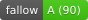

# Geometrica – LineArt Generator

[](https://github.com/Niekes/geometrica/actions/workflows/ci.yml)


[Geometrica](http://niekes.github.io/geometrica) is an interactive **LineArt Generator** that allows you to create, move, and customize geometric shapes like **circles, squares, polygons, and your own SVG paths** to design unique artworks. Stack shapes in **layers**, repeat them geometrically, fill them with **color gradients**, and create complex patterns perfect for **icons, illustrations, or design elements**.

## Features

- Unlimited **layers**, each with its own shape, repetition, and colors
- Shape presets: rectangle, circle, polygon — plus **custom SVG path shapes**
- Geometric repetition with amount, distance, and rotation per layer
- Stroke, fill, or fill + stroke with **linear and radial gradients**
- Move, scale, and rotate shapes 🟢🔵🟡
- Adjust border radius and stroke width ✨📏
- Live preview of your artwork 🎥🖌️
- Shareable URLs with automatic migration of old links 🔗
- Export artworks as icons or design assets 🖼️💾

## Technologies

- **[Vue 3](https://vuejs.org/)**
- **[VueUse](https://vueuse.org/)**
- **[TypeScript](https://www.typescriptlang.org/)**
- **[TailwindCSS](https://tailwindcss.com/)**
- **[DaisyUI](https://daisyui.com/)**
- **[HeroIcons](https://heroicons.com/)**
- **[Vite](https://vite.dev/)**

## Installation

```bash
npm install
```

### Development

```bash
npm run dev
```
